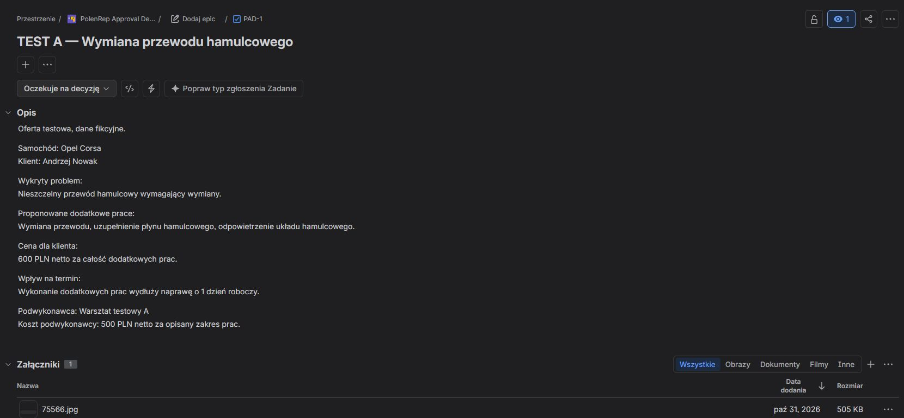
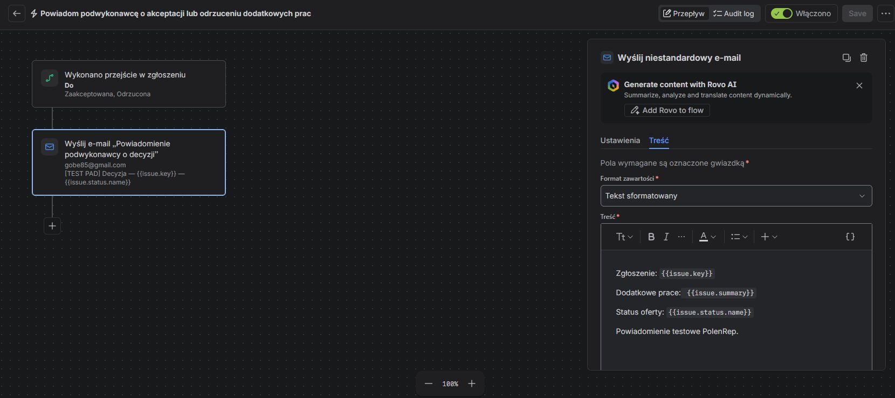
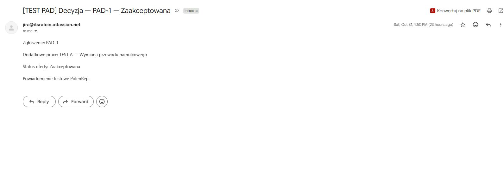

# PolenRep Legacy-to-Digital Case Study

## Business Context

PolenRep manages international vehicle repair and restoration projects.
A workshop may identify additional work outside the previously
approved scope. The work must be explained, priced and approved by
the customer before it can proceed.

## AS-IS Process

The workshop reports the problem, proposed repair, evidence and
estimated cost to the PolenRep project manager through email,
WhatsApp or phone calls.

The project manager reviews the information, prepares a customer-facing
proposal and sends it to the customer. The customer can approve,
reject or request more information. Questions and answers pass through
the project manager until the customer makes a final decision.
The project manager records that decision and communicates it to
the workshop.

The process works, but follow-up and information transfer are manual.

## Requirements Analysis

The proposed digital process needed to support:

- registration of additional work for a specific vehicle project;
- photos and supporting evidence;
- separate subcontractor cost and customer-facing price;
- presentation of the proposal to the customer;
- approval, rejection or further questions;
- recording the customer's decision;
- communication of the decision to the correct workshop.

Invoicing, parts procurement, workshop scheduling and complete
customer project management were outside the scope.

## Target Process

1. The workshop registers the additional work and evidence.
2. The project manager reviews the request and prepares the
   customer-facing quotation.
3. The customer receives the proposal.
4. The customer approves, rejects or asks a question.
5. The decision or question is recorded against the correct request.
   Questions return to the project manager for clarification.
6. Once the customer approves or rejects, the workshop receives
   the final decision.

## Backlog and Sprint

The requirements became one Epic and 11 user stories in Jira.
Sprint 1 was run as a simulation with six core stories covering
registration, evidence, quotation preparation, the approval request,
recording the decision and informing the workshop.

Sprint Goal:

> Create a usable end-to-end flow for handling additional work
> requests from subcontractor submission to communicating the
> customer's final decision.

Configured sprint dates in Jira: 2026-10-15 to 2026-10-29.  
The sprint was verified as closed on 2026-11-01.

PLD-6–9, covering the customer question-and-answer loop, remained
in the backlog. PLD-10 also includes further customer questions,
creating a scope overlap to address before implementing that flow.

See the [backlog](backlog.md) for the original stories and acceptance criteria.

## Implemented and Tested Result

A working prototype was configured in a separate Jira space:
PolenRep Approval Demo (PAD).

PAD-1 represents a fictional request to replace a brake hose.
Its description contains vehicle and customer information, the problem,
proposed work, subcontractor cost, customer-facing price and schedule
impact. A photo is attached. Pending requests can be viewed by filtering
the list by status.

The project manager manually records the customer's decision by
changing PAD-1's status. A Jira Automation rule triggers on transitions
to Zaakceptowana (Accepted) or Odrzucona (Rejected) and sends an email
to one fixed test inbox representing the workshop.

The email uses smart values to insert the task key, summary and
current status. The PM is the person recording the decision in this
prototype; the email demonstrates the subsequent handoff to the workshop.

## Test Results

Three notification scenarios were checked:

1. Acceptance — the email arrived with PAD-1, the correct summary
   and the status Zaakceptowana.
2. Rejection — the email arrived with PAD-1, the correct summary
   and the status Odrzucona.
3. Pending decision — changing the status to Oczekuje na decyzję
   did not send a decision email.

No defects were observed in these checks. Tests used fictional request
data and the project owner's email address as the workshop's test inbox.

## Configuration and Test Evidence

Screenshots captured on 2026-11-01 show the configuration and
an email received during testing on 2026-10-31.

### PAD-1 Request

Additional-work information recorded in the task description, with
separate subcontractor cost and customer-facing price.

### Enabled Automation

The rule triggers on accepted or rejected status and sends an email
using the task key, summary and status.

### Received Acceptance Email

The received message shows PAD-1, the repair title and the accepted status.

## Scope Change

A change-control simulation considered an automatic reminder after
48 hours without a customer response, including its effort, price and
the cost of earlier testing. The commissioning customer approved
the earlier-testing option within that scenario.

The requirement was recorded as PLD-12 and remains unimplemented
in the prototype. See [CR-01](change_log.md) for the scenario decision
and current backlog position.

## Risks and Issues

An attachment-access problem was handled in the sprint simulation:
PLD-3 was reopened, correction and retesting were recorded, and the
story was returned to Done.

Subcontractor adoption of the digital workflow remains an open
assumption to validate in a pilot or user acceptance testing (UAT).
See the [RAID log](raid_log.md).

## Actual Result and Limitations

The working result is structured recording of additional work and
automated notification after a manually recorded customer decision.

Customer submission, automatic capture of the customer's response,
the question-and-answer loop and routing to actual subcontractors
were not implemented. The simulated story statuses therefore do not
represent delivery of the full end-to-end Sprint Goal.

## Backlog Decision

Consider PLD-6–9 together as the next functional area: the
question-and-answer flow between the customer, PolenRep and the workshop.
Resolve its overlap with PLD-10 during planning. PLD-12 remains a later
enhancement. Further implementation requires its own scope and schedule.

## Lessons Learned

Define the prototype's scope and its relationship to the backlog
before configuration starts. Agree on observable test results for
each function being demonstrated.

Use functional evidence, such as received notifications, to assess
the result against the requirements.
